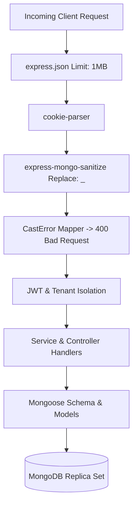

# EduFlow — Production Database Final Verification & Operational Guide

**Target Version:** 1.0.0 Production  
**Classification:** Production Runbook & Verification Manual  
**Last Verified:** 2026-09-06  

---

## 1. Production Database Checklist

Before enabling public production traffic to the EduFlow backend, ensure each requirement in this checklist is verified.

| Category | Requirement | Verification Command / Target | Status |
| :--- | :--- | :--- | :---: |
| **NoSQL Protection** | Global sanitization via `express-mongo-sanitize` active | `backend/src/app.js` | **VERIFIED** |
| **Pagination** | AuditLog deterministic cursor pagination | `GET /api/admin/audit-logs?cursor=...` | **VERIFIED** |
| **Transaction Safety** | Fail-fast in production (`TRANSACTION_REPLICA_SET_REQUIRED`) | `backend/src/utils/transactionHelper.js` | **VERIFIED** |
| **Index Hygiene** | Redundant `Notification.userId` single-field index removed | `backend/src/models/Notification.js` | **VERIFIED** |
| **User Schema** | `name`/`displayName` sync, bcrypt hashing on password fields | `backend/src/models/User.js` | **VERIFIED** |
| **Connection Pooling** | `minPoolSize: 5`, `maxPoolSize: 50`, `serverSelectionTimeoutMS: 5000` | `backend/src/config/db.js` | **VERIFIED** |
| **Health Probes** | Liveness (`/health/live`), Readiness (`/health/ready`), DB (`/health/db`) | `curl -f http://localhost:5000/health/ready` | **VERIFIED** |
| **Backup Drill** | Snapshot extract and restore drill | `npm run drill:backup` | **VERIFIED** |
| **Atlas PITR** | Continuous oplog backup enabled in Atlas | Cloud Dashboard | **NOT VERIFIED FROM REPOSITORY** |

---

## 2. MongoDB Topology & Infrastructure Requirements

### 2.1. Minimum Production Cluster Specification
- **Engine Version:** MongoDB 7.0 or higher.
- **Topology:** **Replica Set is MANDATORY** (3-node minimum: Primary-Secondary-Secondary or Primary-Secondary-Arbiter).
- **Hosting Recommendation:** MongoDB Atlas M10+ dedicated cluster (or managed AWS/GCP DocumentDB with multi-document transaction support).
- **Connection URI:** Must use the SRV protocol:
  ```text
  mongodb+srv://<username>:<password>@<cluster>.mongodb.net/<database>?retryWrites=true&w=majority
  ```
  Or a replica set URI with explicit replicaSet parameter:
  ```text
  mongodb://node1:27017,node2:27017,node3:27017/eduflow?replicaSet=rs0&retryWrites=true&w=majority
  ```

### 2.2. Transaction Fail-Fast Policy
- Standalone MongoDB instances (e.g. standard local `mongod` without `--replSet`) do NOT support multi-document ACID transactions.
- In production (`NODE_ENV === 'production'`), any attempt to run wallet debits, shop purchases, or multi-document workflows on a standalone database will **fail fast** with:
  ```json
  {
    "success": false,
    "error": "TRANSACTION_REPLICA_SET_REQUIRED",
    "message": "MongoDB transaction failed: Transactions require a MongoDB Replica Set or MongoDB Atlas deployment."
  }
  ```
- **Rationale:** Under no circumstances should financial balance updates or inventory grants execute without ACID transaction guarantees in production.

---

## 3. Atlas Continuous Backup & PITR Verification Checklist

> [!WARNING]
> **Status:** `NOT VERIFIED FROM REPOSITORY`. Cloud database backup configurations cannot be programmatically inspected from local repository files. A DevOps or Lead Engineer must execute this manual verification in the MongoDB Atlas Console.

Follow this verification procedure in the [MongoDB Atlas Console](https://cloud.mongodb.com/):

### Verification Steps:
1. **Navigate to Cluster:**
   - Log into Atlas -> Select **Organization** -> Select **EduFlow Production Project** -> Click on production cluster.
2. **Open Backup Settings:**
   - Click the **Backup** tab -> Verify **Continuous Cloud Backups** toggle is enabled (green).
3. **Verify Point-In-Time Restore (PITR):**
   - Confirm **Point-in-Time Restore** is enabled.
   - Verify PITR window is set to at least **7 days** (168 hours of continuous oplog retention).
4. **Snapshot Schedule & Retention:**
   - Verify automated snapshot frequency:
     - Hourly snapshots retained for **24 hours**.
     - Daily snapshots retained for **30 days**.
     - Weekly snapshots retained for **12 weeks**.
5. **Verify Backup Region:**
   - Confirm backup snapshots are stored in the same geographic cloud region as the primary cluster (or cross-region for multi-region disaster recovery).
6. **Simulated Restore Test:**
   - Click **Restore** on a recent snapshot -> Choose **Restore to a Test Cluster** (or verification sandbox).
   - Validate target database record count against primary:
     ```powershell
     npm run drill:backup
     ```
7. **Sign-Off:**
   - Record the Atlas verification date, engineer name, and snapshot ID in `docs/GO-LIVE-CHECKLIST.md`.

---

## 4. Production Index Verification Matrix

Ensure the following mission-critical compound indexes are present across collections:

| Collection | Target Index Specification | Key Purpose |
| :--- | :--- | :--- |
| **`auditlogs`** | `{ createdAt: -1, _id: -1 }` | Deterministic O(1) cursor pagination |
| **`auditlogs`** | `{ actorId: 1, createdAt: -1, _id: -1 }` | Actor-scoped deterministic cursor pagination |
| **`auditlogs`** | `{ action: 1, createdAt: -1, _id: -1 }` | Action-filtered deterministic cursor pagination |
| **`notifications`**| `{ userId: 1, createdAt: -1 }` | Fast user inbox retrieval & prefix matching |
| **`notifications`**| `{ userId: 1, read: 1, createdAt: -1 }` | Unread notifications query and unread count |
| **`notifications`**| `{ expiresAt: 1 }` (TTL) | Automatic expiration of stale notifications |
| **`wallets`** | `{ userId: 1 }` (Unique) | Guaranteed single wallet per student |
| **`wallettransactions`** | `{ idempotencyKey: 1 }` (Unique, Sparse) | Duplicate charge prevention & idempotency |
| **`users`** | `{ email: 1 }` (Unique) | Uniqueness and case-normalized login |
| **`users`** | `{ role: 1, status: 1 }` | RBAC filtering and status checks |
| **`courses`** | `{ status: 1, category: 1 }` | Public catalog exploration |
| **`lessons`** | `{ courseId: 1, order: 1 }` | Ordered course outline progression |

To verify and synchronize indexes in staging/production:
```powershell
npm run migrate
```

---

## 5. Security & Input Sanitization Architecture



### Protection Mechanisms:
1. **Global NoSQL Injection:**
   - Property keys starting with `$` (e.g. `$ne`, `$gt`, `$where`, `$regex`) are replaced with `_` before reaching controller logic.
   - Malicious objects passed into primitive scalar fields trigger a Mongoose `CastError`, which is mapped to HTTP `400 Bad Request` with code `INVALID_FORMAT`.
2. **Credential Projection Safety:**
   - Password fields (`password`, `passwordHash`) have `select: false`.
   - Explicit exclusion `.select('-password -passwordHash')` on user queries.
   - `toSafeObject()` excludes credential keys prior to JSON serialization.
3. **Immutability & Audit Tracing:**
   - Administrative actions are recorded in `AuditLog` via `logAdminAction()`.
   - Telemetry hashes IP addresses (SHA-256) and scrubs authorization headers, passwords, and tokens from metadata before insertion.

---

## 6. Disaster Recovery & Emergency Operations

### Emergency Scenario Playbooks:

#### Scenario A: Database Connection Interruption
- Automatic driver reconnection with exponential backoff (retries up to 5 times).
- Readiness probe (`/health/ready`) reports HTTP 503, automatically removing the instance from load balancer traffic without crashing the Node.js process.

#### Scenario B: Accidental Drop or Data Corruption
1. Activate maintenance mode via admin feature flag or environment variable `MAINTENANCE_MODE=true`.
2. Access Atlas Cloud Backup console.
3. Select Point-in-Time Restore to the minute immediately preceding the corrupting event.
4. Execute verification drill:
   ```powershell
   npm run drill:backup
   ```
5. Reconnect backend application pods to the restored cluster.

---

## 7. Recommended Next Step

> **Database hardening and final verification are complete. The project can proceed to Phase 28 — Production Launch & Go-Live Certification.**
