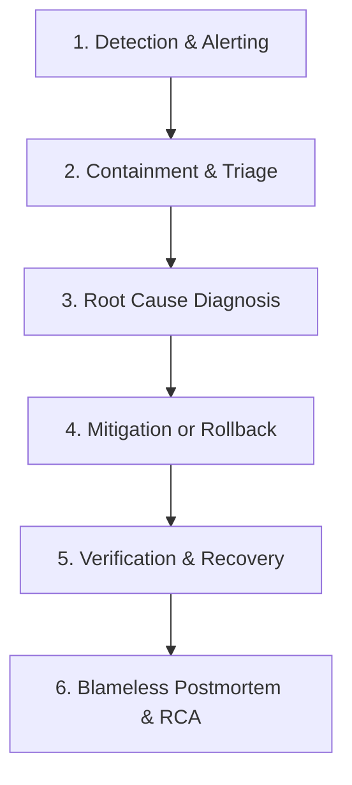

# Phase 28: Production Incident Response Plan & Runbooks

**Application:** EduFlow Production Baseline  
**Date:** September 6, 2026  
**Auditor:** Senior Production Engineer  
**Classification:** Operational Reliability & Emergency Incident Runbook  

---

## 1. Incident Severity Classification Framework

| Severity Level | Definition | Target MTTA (Acknowledge) | Target MTTR (Resolve) | Typical Scenarios |
| :--- | :--- | :---: | :---: | :--- |
| **P0 — Critical** | Total platform outage, critical data corruption, active security breach, financial double-spend exploit. | **< 5 minutes** | **< 30 minutes** | Complete site down; database unreachable; auth bypass; payment double charge. |
| **P1 — High** | Core educational flow impaired for majority of users; critical integration down without graceful degradation. | **< 15 minutes** | **< 2 hours** | AI Mentor failing completely; quizzes failing to submit; shop purchases failing. |
| **P2 — Medium** | Non-critical feature impaired; workaround available; elevated latency; single service degraded. | **< 1 hour** | **< 8 hours** | Leaderboard delay; slow search autocomplete; batch notification delivery delay. |
| **P3 — Low** | Minor cosmetic defect; non-blocking bug; localized edge case. | **< 24 hours** | Next Sprint | Minor UI styling glitch; localized typo in educational analytics summary. |

---

## 2. Standard Incident Workflow Lifecycle

1. **Detection**: Identified via health probes (`/health/live`, `/health/ready`), automated APM alerts, or user reports.
2. **Containment**: Limit the blast radius immediately (e.g. enable maintenance mode, engage circuit breakers, isolate corrupted nodes).
3. **Diagnosis**: Inspect structured JSON logs via `X-Request-Id`, examine MongoDB query metrics, and review recent deployment diffs.
4. **Mitigation**: Deploy hotfix, execute rollback runbook, or toggle dynamic feature flags.
5. **Recovery**: Verify system health via automated smoke tests (`npm run test:smoke`), restore traffic, and monitor error rates.
6. **Postmortem**: Complete blame-free Post-Incident Review within 24 hours.

---

## 3. Specific Production Incident Runbooks

### 3.1. Backend Outage / Complete Process Crash
- **Detection**: Load balancer health checks fail; `/health/live` returns connection refused or 502/504 Bad Gateway.
- **Containment**: Route incoming edge traffic to static maintenance page via CDN.
- **Diagnosis**: Check process logs for uncaught exceptions, OOM (Out-of-Memory) killer events, or unhandled promise rejections.
- **Mitigation**: Restart backend process containers; verify Node.js memory limit (`--max-old-space-size=2048`).
- **Rollback**: If triggered by recent release, execute `kubectl rollout undo` or redeploy prior Docker image tag.
- **Recovery**: Confirm `/health/live` returns HTTP 200 with valid process uptime.

### 3.2. Database Outage / Connection Exhaustion
- **Detection**: API requests return HTTP 503; logs display `MongoServerSelectionError` or `connection pool exhausted`.
- **Containment**: Engage circuit breaker to prevent cascading stampede against database.
- **Diagnosis**: Inspect MongoDB Atlas CPU/RAM and connection pool metrics. Check for unindexed collection scans.
- **Mitigation**: Verify MongoDB Atlas replica set failover. If connection pool exhausted, scale cluster or increment `MONGODB_MAX_POOL_SIZE`.
- **Rollback**: If caused by unindexed schema release, run `npm run migrate` to apply missing compound indexes.
- **Recovery**: Confirm `/health/ready` returns readyState 1 and database status `connected`.

### 3.3. Authentication Failure / Token Compromise
- **Detection**: Sudden spike in HTTP 401/403 responses; reports of session drops or invalid token errors.
- **Containment**: If secrets compromised, immediately revoke active sessions via admin endpoint (`/api/admin/users/invalidate-sessions`).
- **Diagnosis**: Verify whether `JWT_ACCESS_SECRET` or `JWT_REFRESH_SECRET` was rotated without coordinated rollout.
- **Mitigation**: Issue fresh high-entropy secrets in secret manager; trigger coordinated rolling restart of API pods.
- **Rollback**: Revert secret vault to previous revision if misconfiguration caused rejection of valid tokens.
- **Recovery**: Run authentication smoke tests to confirm registration, login, and token rotation succeed cleanly.

### 3.4. Payment & Billing Failure / Webhook Mismatch
- **Detection**: Repeated HTTP 400/401 on `/api/billing/webhook`; failed checkout complaints.
- **Containment**: Webhook events enter retry queue; subscriptions retain 3-day grace period without terminating student access.
- **Diagnosis**: Check if `STRIPE_WEBHOOK_SECRET` in environment matches the secret generated in payment gateway console.
- **Mitigation**: Update webhook secret in environment variable vault; trigger backend restart.
- **Rollback**: If buggy handler code, revert billing controller to previous stable release.
- **Recovery**: Replay unhandled webhooks from payment provider dashboard; verify idempotency prevents duplicate credits.

### 3.5. AI Provider Outage / Elevated Upstream Timeouts
- **Detection**: `openai-service` circuit breaker trips to `OPEN`; `/health/ready` indicates breaker status `OPEN`.
- **Containment**: System automatically serves pedagogical fallback responses without crashing student chat sessions.
- **Diagnosis**: Check OpenAI / Gemini status pages for regional API outages. Check for quota limits or billing blocks.
- **Mitigation**: If quota exhausted, update API key in vault. If model degraded, switch `AI_MODEL` to fallback model.
- **Rollback**: Toggle admin feature flag `ai_mentor_v2=false` to use cached educational templates.
- **Recovery**: Monitor circuit breaker until it transitions from `HALF_OPEN` to `CLOSED`.

### 3.6. Email Delivery Outage
- **Detection**: Notification job logs indicate `SMTP_CONNECTION_ERROR` or SendGrid/Resend API failures.
- **Containment**: `EmailNotificationProvider` automatically skips delivery without failing user registration or password reset flows.
- **Diagnosis**: Verify SMTP credentials, rate limits, or sender domain DNS verification (SPF/DKIM/DMARC).
- **Mitigation**: Update SMTP relay settings or switch to secondary email provider API key.
- **Rollback**: None required; email failures do not corrupt data or block synchronous HTTP requests.
- **Recovery**: Re-queue unsent transactional emails via notification scheduler.

### 3.7. Deployment Failure / Failed Container Launch
- **Detection**: Container orchestrator marks new deployment unhealthy; pods stuck in `CrashLoopBackOff`.
- **Containment**: Automated rollback: deployment pipeline refuses to promote unhealthy pods to live load balancer.
- **Diagnosis**: Inspect container startup logs; check for failed `validateEnv()` checks (e.g. missing required secret).
- **Mitigation**: Provide missing environment variable in deployment console and trigger rebuild.
- **Rollback**: Abort deployment; keep existing active stable pods running.
- **Recovery**: Verify `validateEnv()` passes in staging environment prior to retrying production deployment.

### 3.8. Data Integrity Issue / Concurrent Balance Anomaly
- **Detection**: Discrepancy detected in `WalletTransaction` or inventory ledger.
- **Containment**: Activate `maintenance_mode=true` via feature flag to halt mutating transactions immediately.
- **Diagnosis**: Query affected user audit logs and transaction history; verify if race condition occurred.
- **Mitigation**: Execute database compensation script to reconcile balances to verified ledger entries.
- **Rollback**: If wide-scale corruption occurred, execute Point-In-Time Restore (PITR) to pre-incident minute.
- **Recovery**: Run `npm run drill:backup` and `npm run test:db` against restored database.

### 3.9. Security Incident / Unauthorized Access Attempt
- **Detection**: WAF alert triggers on high volume of NoSQL injection, path traversal, or credential stuffing attempts.
- **Containment**: Cloudflare / edge WAF blocks source IP ranges; rate limiters automatically throttle requests.
- **Diagnosis**: Inspect `AuditLog` collection for unauthorized actor actions; examine request headers and source IPs.
- **Mitigation**: Add attacker IP blocks to edge firewall; force session invalidation for targeted accounts.
- **Rollback**: Revert any unauthorized administrative modifications identified in AuditLog.
- **Recovery**: Re-verify security perimeter with `npm run test:adversarial`.

### 3.10. Elevated Error Rate / Memory Leak (5xx Spike)
- **Detection**: Prometheus / CloudWatch alert fires when 5xx error rate exceeds 1% for 3 minutes.
- **Containment**: Provision additional container replicas to absorb traffic; isolate leaking instances.
- **Diagnosis**: Profile heap memory usage; review recent git commits for unhandled async loops or unclosed file handles.
- **Mitigation**: Deploy hotfix or restart leaking containers via automated health check watchdog.
- **Rollback**: Trigger backend container rollback to prior stable tag.
- **Recovery**: Verify memory footprint stabilizes below 180MB RSS under normal load.

---

## 4. Post-Mortem & Root Cause Analysis (RCA) Protocol

Within 24 hours of resolving any P0 or P1 incident:
1. Conduct a blame-free engineering post-mortem meeting.
2. Publish post-mortem report including:
   - **Summary of Incident & Impact**: Affected users, services, duration.
   - **Timeline**: Exact timestamps for detection, triage, mitigation, and recovery.
   - **Root Cause Analysis**: 5 Whys analysis identifying underlying system defect.
   - **Corrective Actions**: Preventative engineering tasks with owners and due dates.
